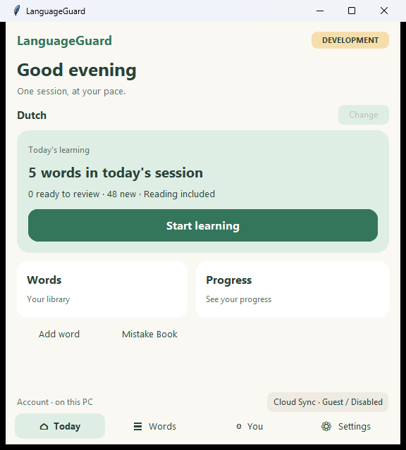
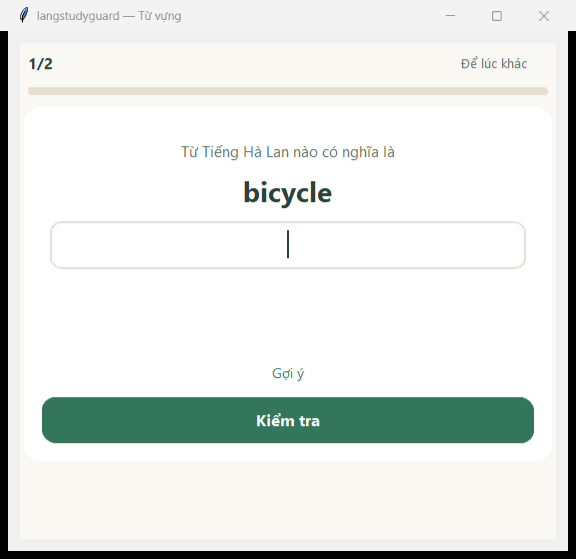
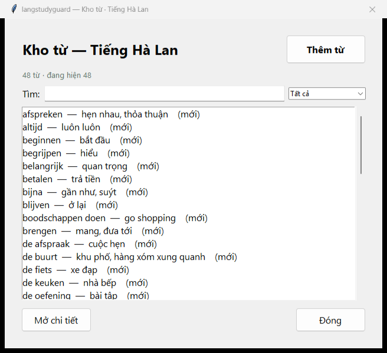
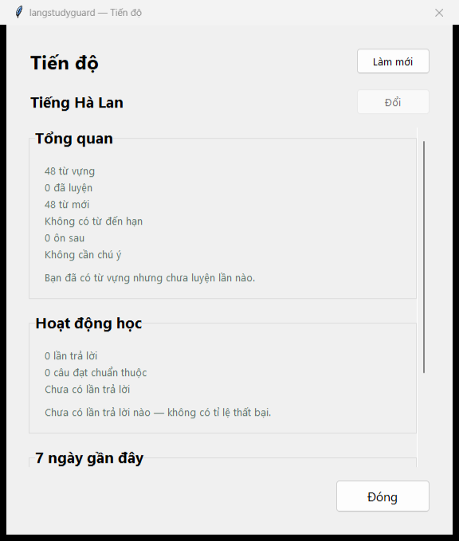
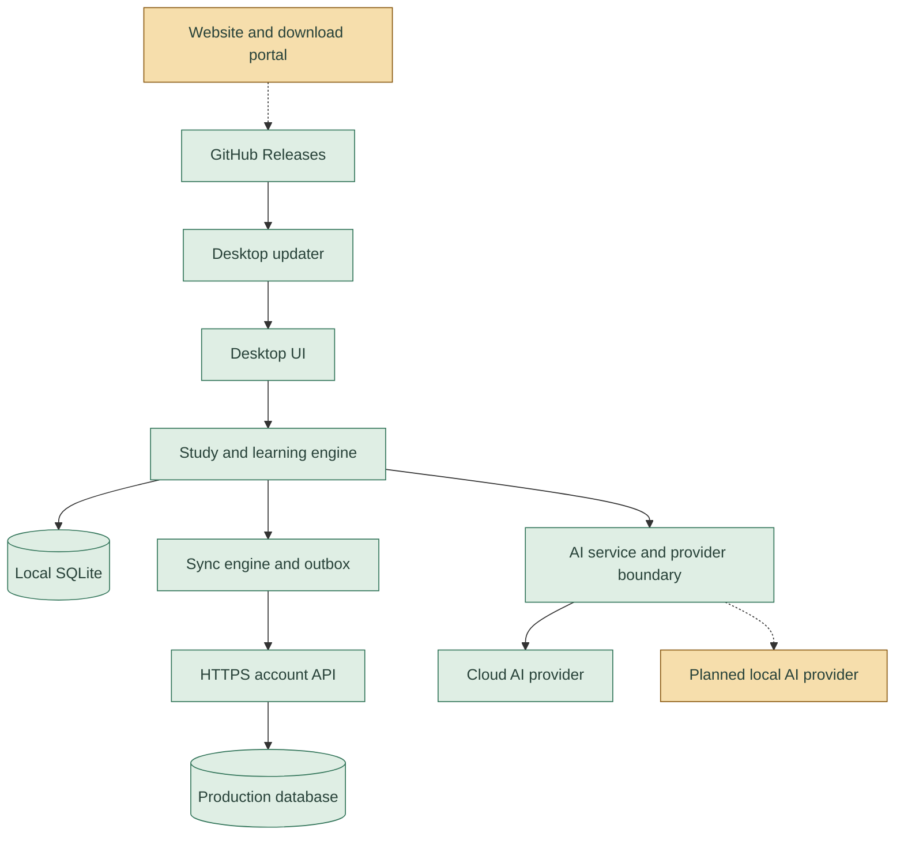

# LanguageGuard — AI-Powered Language Learning Platform

LanguageGuard is a Windows desktop product for daily language study. Learning data stays on the computer first. An optional account can synchronize that data across devices, and optional AI features add sentence feedback and generated reading. The public source repository is [EnglishApp](https://github.com/nguyenthaibinh19/EnglishApp).

The current public release is a local-first study application with account sync for a controlled pilot. It is not a finished consumer platform, and several parts of the ecosystem are still in development.

[](https://github.com/nguyenthaibinh19/EnglishApp/releases/tag/v1.5.0)
[](docs/PROJECT_OVERVIEW.md)
[](docs/PROJECT_OVERVIEW.md)

The test badge is the v1.5.0 release checkpoint. This repository does not publish a continuously updated CI status.

- [GitHub Releases](https://github.com/nguyenthaibinh19/EnglishApp/releases)
- [Installation](#9-getting-started)
- Account and API host: [https://langstudyguard.com](https://langstudyguard.com)
- [Documentation](.ai/README.md) and [project overview](docs/PROJECT_OVERVIEW.md)

`langstudyguard.com` is the deployed account and sync API used by the desktop release. A separate public marketing website is in development and is not deployed at that domain.

## Product screenshots

These images come from synthetic development profiles. They contain starter vocabulary only. They are not captures of a personal learner account.

| | |
|---|---|
|  |  |
| Phase 19 development preview of the home dashboard. This layout is not in released v1.5.0. | Phase 19 development preview of the vocabulary study card. Released v1.5.0 still uses the earlier study window. |
|  |  |
| Vocabulary library with the bundled Dutch starter list, from a synthetic development profile. | Progress overview for that same starter profile. No study history has been recorded. |

A signed-in Cloud Sync state is not shown. Guest mode correctly reports sync as disabled. No website or local-AI screenshot is included: the website is not publicly deployed, and local AI is a separate private workstream.

Source on `main` after 2026-11-27 also contains work that is not in the v1.5.0 download: the Phase 19.2B CustomTkinter home and study presentation (PR #31), and Phase 19.3 local speech (PR #32). That speech path prefers System.Speech and uses Windows.Media.SpeechSynthesis only for a same-language gap or an explicitly saved WinRT voice. It does not call a cloud voice. On the development PC used for the audible check, French and Italian had no voice. The public download remains v1.5.0.

## Core features

Released v1.5.0 includes:

- Seven study languages: Dutch, English, French, German, Spanish, Italian, and Portuguese. The interface language is separate and can be Vietnamese or English.
- Vocabulary practice and a vocabulary library, with stable IDs so a renamed word keeps its history.
- Spaced repetition and a daily study plan that chooses due reviews and new words.
- Attempt History and a Mistake Book derived from the latest attempt.
- AI sentence feedback and AI-generated reading exercises, called through the account server. The desktop build does not contain an API key.
- Listening practice that uses compatible Windows voices already installed on the PC. A missing voice makes listening unavailable for that language only. The product does not claim that all seven languages have a voice on every computer, and it does not fall back to another language or to an online voice.
- Local-first storage. Study remains possible without a network.
- Account synchronization for a controlled pilot: an offline outbox, explicit conflict handling, and idempotent progress events. Guest data stays on the PC.
- Optional screen lock. It stays off until the learner confirms an emergency code on that computer. The code is protected with Windows DPAPI and is not shipped in the download.
- A Windows install and update flow. The app can place itself in the user profile and offer a newer GitHub Release.

## LanguageGuard ecosystem

LanguageGuard is three workstreams with separate repositories. Only the desktop application and its account API are publicly released.

### Desktop app and cloud backend

The public [EnglishApp](https://github.com/nguyenthaibinh19/EnglishApp) repository holds the Python desktop application, the account server, and the release process. Learning state and account data use SQLite. The desktop release talks to the account API over HTTPS. The API is deployed on a Hetzner server and is reached at `https://langstudyguard.com`. Installers are published as [GitHub Releases](https://github.com/nguyenthaibinh19/EnglishApp/releases).

### Website

A separate, private Astro project is the intended product and download portal. Its job is public explanation and a safe path to the desktop download. Production deployment of that site is not authorized, and this README does not treat `langstudyguard.com` as that website. No public website screenshot is available.

### Local AI runtime

A separate, private local-AI repository is intended to reduce dependence on an external model provider. The desktop app already has a provider-independent AI boundary. The accepted App–AI contract is **C-APP-AI-001 v0.2.0**. The public app repository includes consumer conformance tests for that contract. A future `LocalAIProvider` would plug into the same boundary.

That local runtime is not integrated into released v1.5.0. The release still uses the account server, which calls the existing cloud provider. Private models, datasets, and runtime source are not part of this repository.

## System architecture

Deployed pieces are green. Planned pieces are amber.



The important data rules are:

- The PC is the working copy. Sync is continuity across devices, not a requirement for opening the app.
- Each account has its own local database. One account cannot read another account's rows.
- Vocabulary keeps a stable UUID. Spelling can change without orphaning progress or attempts.
- Progress events are idempotent. Repeating the same accepted event does not create a second learning record.
- A revision mismatch becomes an explicit conflict. The app does not silently pick a winner.

More detail is in the [project overview](docs/PROJECT_OVERVIEW.md) and in [architecture.md](.ai/architecture.md).

## Technology stack

| Area | Released or in active use | Development stage |
|---|---|---|
| Desktop and UI | Python, Tkinter, ttk | CustomTkinter home and study presentation, merged to main and not in v1.5.0. |
| Backend | Python account service, HTTPS | |
| Database | SQLite on the desktop and on the server | |
| AI integration | Provider boundary, cloud model through the account server | |
| Local AI | | Private runtime and C-APP-AI-001. Not wired into the release. |
| Web | | Private Astro site. Not deployed. |
| Infrastructure | Hetzner, Caddy, systemd services, scheduled backups | Google Drive off-box backup is designed and not operational. |
| Testing | pytest. The v1.5.0 checkpoint is recorded below. | |
| Packaging | PyInstaller, GitHub Releases, in-app updater | The Windows executable is unsigned. |

## Engineering and development workflow

LanguageGuard is built by the product owner with supervised AI assistance. Agents do not merge, deploy, or change production on their own.

| Role | Responsibility |
|---|---|
| Product owner | Sets the product vision, requirements, priorities, and approvals. |
| ChatGPT | Architecture, planning, and implementation review. |
| Cursor | Application implementation and operations that the owner has authorized for that task. |
| Antigravity | The separate website and local-AI workstreams. |
| Codex | Selective independent testing and review, not a gate on every change. |

The lifecycle is: requirements, architecture, a scoped implementation, tests, an evidence-based review, acceptance, merge, release or deployment, then a documentation handoff.

Day-to-day control uses review branches, Architecture Decision Records, engineering invariants, regression tests, and a written project memory so a later session can continue without guessing. Production changes, including sync activation and deployment, require an explicit authorization. App, website, and local-AI repositories stay separate.

Public workflow notes: [AI agent workflow](.ai/agent_playbook/AI_AGENT_WORKFLOW.md), [invariants](.ai/invariants.md), [decisions](.ai/decisions/), and the [ecosystem registry](.ai/ecosystem/REPO_REGISTRY.md).

## Reliability and engineering achievements

These are verified outcomes of the v1.5.0 release work. They are not a live dashboard.

- Windows v1.5.0 is published: [v1.5.0 — Account Cloud Sync Update](https://github.com/nguyenthaibinh19/EnglishApp/releases/tag/v1.5.0).
- An installed v1.4.0 application updated itself to v1.5.0 through the existing updater.
- Production Cloud Sync is on for a controlled pilot.
- The sync design supports offline queues and explicit conflicts.
- The server has a scheduled sync-backup timer, and a manual restore check of a backup was verified.
- At the v1.5.0 release checkpoint the suite was **978 passed, 24 skipped, 0 failed**.

Google Drive off-box backup is not operational. This page does not report private learner activity.

## Getting started

### Install the release

1. Open the [v1.5.0 release](https://github.com/nguyenthaibinh19/EnglishApp/releases/tag/v1.5.0).
2. Download `langstudyguard.zip` from that release.
3. Extract it and start `langstudyguard.exe`.

The executable is unsigned. Windows may say the publisher is unknown. Download the zip only from this repository's GitHub Releases. This project does not ask you to disable Windows security checks.

On first launch the app copies itself under `%LOCALAPPDATA%\langstudyguard\` and can add a Startup entry. A later release is offered inside the app. Accepting it replaces the installed program and keeps the local study data.

Sign-in uses an account issued for the pilot. The public release has a login API and does not include open self-service registration. The first run also asks the learner to choose or generate an emergency code on that PC. Screen lock remains off until that code is confirmed. The code stays on the device.

### Develop from source

Python 3.13 is the interpreter used for the v1.5.0 Windows build. From a clone:

```text
py -3 -m pip install -r requirements.txt
copy .env.example .env
py -3 main.py
py -3 -m pytest
```

`.env` is local and ignored by git. Do not commit it. For development, point `ACCOUNT_SERVER_URL` at a local server. Do not point `LG_DATA_DIR` at the production `%APPDATA%\langstudyguard` folder, and do not reuse a production session token. `LOCK_SCREEN=0` in `.env` keeps the window from taking over the desktop while you work. The installed release no longer uses a shared emergency password from `.env`.

There is no GitHub Actions release pipeline in this repository. Packaging notes are in [How to release](.ai/procedures/HOW_TO_RELEASE.md).

## Roadmap and limitations

Current development, not released behavior:

- A CustomTkinter desktop presentation, including the home and study previews above.
- Adaptive vocabulary practice, multiple choice, and assisted recall.
- Independent writing, progressive sentence practice, and a grammar companion.
- Multilingual text-to-speech beyond whatever Windows voices are already installed.
- The public website.
- Local AI integration through `LocalAIProvider`.
- Off-box backups and further production hardening.

The sync service is a controlled pilot. Accounts are issued rather than openly registered. Listening depends on the voices installed in Windows. The desktop executable is unsigned. The marketing site and the local AI runtime are separate and are not part of the v1.5.0 download.

## Further reading

The engineering map, including which older notes are historical, is in the [project overview](docs/PROJECT_OVERVIEW.md). This repository does not currently include a top-level license file.
